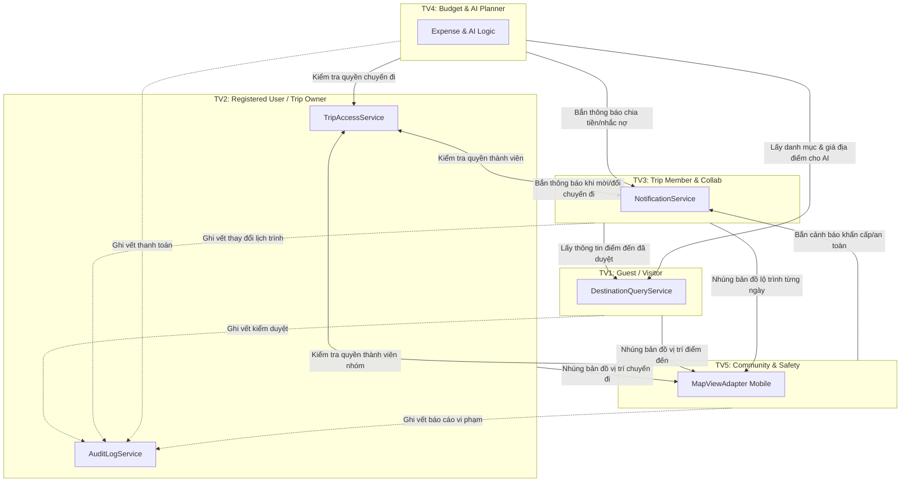

# QUY CHUẨN LẬP TRÌNH VÀ NGUYÊN TẮC LÀM VIỆC THEO ACTOR (VISTA TEAM CODING RULES)

> **Mô hình:** Phân chia theo **5 Actor chính (TV1 – TV5)** kết hợp **Full-Stack Vertical Slices**  
> **Mục tiêu:** 5 lập trình viên code song song độc lập từ Giao diện (Mobile/Admin) tới Backend và Database mà **không dẫm chân lên nhau**, không gây conflict mã nguồn, duy trì chất lượng kỹ thuật cao cấp chuẩn Production.

---

## 📌 MỤC LỤC
1. [Nguyên Tắc Vàng (Bất Di Bất Dịch)](#1-nguyên-tắc-vàng-bất-di-bất-dịch)
2. [Ma Trận Phân Công & Sở Hữu Theo 5 Actor](#2-ma-trận-phân-công--sở-hữu-theo-5-actor)
3. [Ranh Giới Module & Hợp Đồng Giao Tiếp Liên-Actor](#3-ranh-giới-module--hợp-đồng-giao-tiếp-liên-actor)
4. [Checklist Bắt Buộc "TRƯỚC KHI CODE" (Pre-Coding)](#4-checklist-bắt-buộc-trước-khi-code-pre-coding)
5. [Quy Chuẩn Viết Code Cho Backend (Java / Spring Boot)](#5-quy-chuẩn-viết-code-cho-backend-java--spring-boot)
6. [Quy Chuẩn Viết Code Cho Mobile (React Native / Expo Router)](#6-quy-chuẩn-viết-code-cho-mobile-react-native--expo-router)
7. [Quy Chuẩn Viết Code Cho Web Admin (Next.js App Router)](#7-quy-chuẩn-viết-code-cho-web-admin-nextjs-app-router)
8. [Quy Chuẩn Cơ Sở Dữ Liệu & Flyway Migrations](#8-quy-chuẩn-cơ-sở-dữ-liệu--flyway-migrations)
9. [Checklist "SAU KHI CODE" & Quy Trình Mở Pull Request](#9-checklist-sau-khi-code--quy-trình-mở-pull-request)
10. [Quy Tắc Quản Lý File Dùng Chung & Cặp Review PR](#10-quy-tắc-quản-lý-file-dùng-chung--cặp-review-pr)

---

## 1. NGUYÊN TẮC VÀNG (BẤT DI BẤT DỊCH)

1. **SỞ HỮU TRỌN GÓI THEO ACTOR:** Mỗi thành viên chịu trách nhiệm trọn vẹn (Full-Stack) cho Actor của mình: từ Màn hình Mobile/Admin, API Controller, Business Service, Database Entity/Repository cho đến Unit/Integration Test.
2. **RANH GIỚI BẤT BIẾN (NO CROSS-MODULE REPO CALLS):** Module của Actor này **TUYỆT ĐỐI KHÔNG** gọi trực tiếp Repository hay Entity nội bộ của Actor khác. Mọi trao đổi dữ liệu bắt buộc phải đi qua **Public Service Interface** (ví dụ: `TripAccessService`, `DestinationQueryService`, `NotificationService`).
3. **KHÔNG BAO GIỜ CHỜ NHAU (STUB-FIRST):** Chủ sở hữu Interface bắt buộc phải cung cấp bản **Stub** ngay từ Tuần 1. Các thành viên phụ thuộc lập trình trên Stub/Mock, không được lấy lý do "chờ backend/chờ database" để dừng công việc.
4. **CONTRACT-FIRST:** Mọi API giữa Backend và Mobile/Admin phải được khai báo và thống nhất tại `contracts/openapi/openapi.yaml` **TRƯỚC** khi viết code.
5. **TUYỆT ĐỐI KHÔNG COMMIT SECRETS:** Không bao giờ đưa mật khẩu DB, khóa JWT, API Key AI vào Git. Mọi thông tin nhạy cảm phải đọc từ biến môi trường (`.env`).
6. **BẢO TOÀN DI CƯ DATABASE:** Tuyệt đối không bao giờ sửa lại nội dung file Flyway Migration đã merge vào `develop`. Mọi sửa đổi schema bắt buộc phải tạo file migration mới theo định dạng timestamp.

---

## 2. MA TRẬN PHÂN CÔNG & SỞ HỮU THEO 5 ACTOR

| Thành viên | Actor chính | Phạm vi sở hữu chức năng | Trách nhiệm dùng chung | Sản phẩm bàn giao chính |
|---|---|---|---|---|
| **TV1** | **Guest / Visitor** *(Khách vãng lai)* | Khám phá điểm đến: Search, Filter, Destination Detail, Reviews, Favorites. | Khung Mobile dùng chung (`src/app/`, `theme/`, `components/ui/`), type sinh từ OpenAPI, điều phối dữ liệu seed CSV, Web Admin tối giản. | Search, Filter, Detail, Favorites, khung Mobile, Web Admin. |
| **TV2** | **Registered User / Trip Owner** *(Người dùng & Chủ chuyến đi)* | Tài khoản & Chuyến đi cốt lõi: Auth (JWT), Profile, Create Trip, My Trips, Trip Management, Phân quyền Owner/Member. | Backend Core (`common/`, security, exception, audit), Flyway baseline, CI backend, ma trận RBAC, bộ test RLS. | Auth, Profile, Create Trip, My Trips, `TripAccessService`, `AuditLogService`. |
| **TV3** | **Invited User / Trip Member** *(Thành viên nhóm & Cộng tác)* | Cộng tác chuyến đi nhóm: Nhận/duyệt lời mời, Thành viên nhóm, Lịch trình theo ngày, Đề xuất địa điểm, Biểu quyết (Voting). | Hệ thống thông báo In-App và Push Notification cho toàn bộ ứng dụng. | Invitations, Members, Itinerary, Proposals, Voting, `NotificationService`. |
| **TV4** | **Trip Owner / Member (Budget & AI)** *(Quản lý chi phí & Trợ lý AI)* | Chi phí & AI Planner: Thêm/sửa chi phí, phân loại, tính tổng ngân sách, chia tiền (Equal/Custom), AI Itinerary Suggestion (Gemini). | Định mức token/chi phí AI, công thức làm tròn tiền VND, AI Client Wrapper an toàn. | Expenses, Budget, Split Cost, AI Suggestions, prompt engineering. |
| **TV5** | **Community User / Safety User** *(Cộng đồng & An toàn)* | Bản đồ, Cộng đồng & An toàn: Map view, Check-in, Meetup point, Bảng tin cộng đồng, Báo cáo bài viết, Chia sẻ vị trí có đồng thuận (Opt-in). | Component `MapViewAdapter` dùng chung trên Mobile; API hàng đợi kiểm duyệt (Moderation) cho Web Admin. | Map, Check-in, Community Feed, Content Reports, Location Sharing, `MapViewAdapter`. |

---

## 3. RANH GIỚI MODULE & HỢP ĐỒNG GIAO TIẾP LIÊN-ACTOR

Để đảm bảo kiến trúc **Modular Monolith** sạch sẽ, các Actor giao tiếp với nhau qua các Service Interface công khai sau:



### Chi tiết các Interface bắt buộc:

1. **`TripAccessService`** (Sở hữu bởi **TV2**, tiêu thụ bởi **TV3, TV4, TV5**):
   - Đường dẫn: `backend/src/main/java/com/vista/trip/application/TripAccessService.java`
   - Phương thức: `boolean isMember(UUID tripId, UUID userId)`, `boolean isOwner(UUID tripId, UUID userId)`, `void requireMember(UUID tripId, UUID userId)`, `void requireOwner(UUID tripId, UUID userId)`.
   - *Quy tắc:* TV3, TV4, TV5 **bắt buộc** gọi service này ở đầu mỗi API private của chuyến đi, không tự ý query bảng `trips` hay `trip_members`.

2. **`DestinationQueryService`** (Sở hữu bởi **TV1**, tiêu thụ bởi **TV3, TV4**):
   - Đường dẫn: `backend/src/main/java/com/vista/destination/application/DestinationQueryService.java`
   - Phương thức: `Optional<DestinationSummary> findPublishedById(UUID id)`.
   - *Quy tắc:* Chỉ trả về các địa điểm có trạng thái `PUBLISHED`. TV3 (khi thêm điểm dừng lịch trình) và TV4 (khi AI gợi ý địa điểm) chỉ gọi qua service này.

3. **`NotificationService`** (Sở hữu bởi **TV3**, tiêu thụ bởi **TV2, TV4, TV5**):
   - Đường dẫn: `backend/src/main/java/com/vista/notification/application/NotificationService.java`
   - Phương thức: `sendInAppNotification(...)`, `notifyTripMembers(...)`.
   - *Quy tắc:* Không được tự ý insert vào bảng `notifications` của TV3.

4. **`MapViewAdapter`** (Sở hữu bởi **TV5**, tiêu thụ bởi **TV1, TV2, TV3**):
   - Đường dẫn: `mobile/src/features/map/MapViewAdapter.tsx`
   - *Quy tắc:* Mọi màn hình cần hiển thị bản đồ phải sử dụng `<MapViewAdapter center={...} markers={...} />`. Không tự ý import trực tiếp các thư viện Map bên thứ ba vào code của mình.

---

## 4. CHECKLIST BẮT BUỘC "TRƯỚC KHI CODE" (PRE-CODING)

Trước khi mở IDE gõ code, **BẮT BUỘC** mỗi thành viên thực hiện đủ 5 bước:

1. **Bước 1 — Đọc Kỹ Nhiệm Vụ Tuần & User Story:**
   - Đọc kỹ mã task tuần của mình (ví dụ `W1-TV1-01`, `W2-TV3-02`) trong Kế hoạch 8 tuần.
   - Nắm vững Input, Output, mã lỗi HTTP và tiêu chí kiểm thử Given/When/Then.
2. **Bước 2 — Kiểm Tra RBAC Matrix & Trip Access:**
   - Mở [rbac-matrix.md](file:///c:/Users/Lenovo%20LEGION%205/OneDrive/Desktop/VISTA/docs/architecture/rbac-matrix.md).
   - Kiểm tra API thuộc vai trò nào: Public (Guest), Authenticated User, hay yêu cầu Trip Member/Owner.
3. **Bước 3 — Kiểm Tra / Cập Nhật OpenAPI Contract:**
   - Mở `contracts/openapi/openapi.yaml`.
   - Nếu API có thay đổi: Sửa contract trước ➔ chạy `npm run api:validate` ➔ chạy `npm run api:generate` để sinh type.
4. **Bước 4 — Đồng Bộ Code & Tạo Nhánh Git Đúng Chuẩn:**
   - Cập nhật nhánh nền tảng:
     ```bash
     git checkout develop
     git pull origin develop
     ```
   - Tạo nhánh theo cú pháp chuẩn: `feature/<tv>-<module>-<tên_task>`
     - *Ví dụ:* `feature/tv2-auth-jwt`, `feature/tv3-itinerary-crud`, `feature/tv4-split-cost`, `feature/tv5-map-adapter`
5. **Bước 5 — Kiểm Tra Biến Môi Trường Local:**
   - Đảm bảo file `.env` đã trỏ đúng DB Supabase pooler hoặc Docker local.

---

## 5. QUY CHUẨN VIẾT CODE CHO BACKEND (JAVA / SPRING BOOT)

### 5.1. Cấu Trúc Module Theo Actor (Package-by-Feature)
Mỗi module do Actor quản lý được chia thành các package chuẩn:
```text
com.vista.<module>/
├── api/                        # REST Controller, Request/Response DTOs
├── application/                # Business Service, Public Query/Access Interface
├── domain/                     # JPA Entities, Enums (Internal)
└── infrastructure/             # Spring Data JPA Repositories
```

### 5.2. Quy Tắc Viết Code Bắt Buộc
1. **Kiểu dữ liệu tiền tệ:** Bắt buộc dùng `BigDecimal`, **CẤM** dùng `double` hay `float` khi tính toán chi phí (TV4).
2. **Khóa chính ID:** Toàn bộ bảng dùng kiểu `UUID` sinh ngẫu nhiên.
3. **Optimistic Locking:** Các bảng có tính cộng tác đồng thời (`trips`, `itinerary_items`, `proposals`, `posts`) bắt buộc phải có trường:
   ```java
   @Version
   private Long version;
   ```
4. **Xử lý ngoại lệ chuẩn RFC 9457:** Mọi lỗi trả về phải là `ProblemDetail` qua `GlobalExceptionHandler`. Không tự ý trả về chuỗi text thô.
5. **Chạy Spotless trước khi commit:**
   ```powershell
   cd backend
   .\gradlew.bat spotlessApply
   .\gradlew.bat test
   ```

---

## 6. QUY CHUẨN VIẾT CODE CHO MOBILE (REACT NATIVE / EXPO ROUTER)

1. **Cấu trúc Feature rõ ràng:** Mã nguồn chức năng nằm trong `mobile/src/features/<feature_name>/`.
2. **Khung dùng chung do TV1 quản lý:** Không tự ý sửa `mobile/src/theme/`, `mobile/src/components/ui/` nếu chưa mở PR thảo luận với TV1.
3. **Type-Safe 100%:** Dùng type sinh từ `mobile/src/types/api.generated.ts`. Cấm dùng kiểu `any`.
4. **Trạng thái Mạng & Tải:** Mọi màn hình phải có đủ 3 trạng thái: Loading Skeleton, Empty State (khi không có dữ liệu), và Error State (có nút Thử lại).
5. **Kiểm tra linter và typecheck:**
   ```powershell
   cd mobile
   npm run typecheck
   npx eslint .
   ```

---

## 7. QUY CHUẨN VIẾT CODE CHO WEB ADMIN (NEXT.JS APP ROUTER)

1. **Phụ trách chính:** TV1 quản lý khung Web Admin, kết nối API kiểm duyệt của TV5 và CMS điểm đến của TV1.
2. **Server Components Mặc Định:** Tận dụng React Server Components trong `admin/src/app/` để fetch dữ liệu an toàn.
3. **Không Viết Logic Nghiệp Vụ Tại Admin:** Toàn bộ quyền hạn phải được backend kiểm tra qua JWT role `ADMIN` / `MODERATOR`.
4. **Kiểm tra build:**
   ```powershell
   cd admin
   npm run build
   ```

---

## 8. QUY CHUẨN CƠ SỞ DỮ LIỆU & FLYWAY MIGRATIONS

1. **Tên File Migration Chuẩn Tắc:**
   - Format: `V<YYYYMMDD_HHMM>__<tv>_<mô_tả_ngắn>.sql`.
   - *Ví dụ:* `V20261102_0900__tv3_create_itinerary_items.sql`, `V20261104_1400__tv4_create_expenses.sql`.
2. **Quy Tắc Bất Biến (Immutability):**
   - Migration đã merge vào `develop` **CẤM TUYỆT ĐỐI** mở ra sửa đổi.
3. **Bảng phân chia quyền sở hữu DDL:**
   - **TV1:** `destinations`, `destination_categories`, `destination_reviews`, `favorites`.
   - **TV2:** `users`, `roles`, `user_roles`, `user_emergency_contacts`, `trips`, `trip_members`, `audit_logs`.
   - **TV3:** `invitations`, `itinerary_days`, `itinerary_items`, `proposals`, `votes`, `notifications`, `device_tokens`.
   - **TV4:** `expenses`, `expense_splits`, `budgets`, `ai_generation_jobs`, `ai_feedback`.
   - **TV5:** `posts`, `post_comments`, `content_reports`, `moderation_events`, `check_ins`, `location_shares`, `meetup_points`.

---

## 9. CHECKLIST "SAU KHI CODE" & QUY TRÌNH MỞ PULL REQUEST

Trước khi commit và push code lên GitHub:

```powershell
# 1. Kiểm tra Backend:
cd backend
.\gradlew.bat spotlessApply
.\gradlew.bat test

# 2. Kiểm tra Mobile:
cd mobile
npm run typecheck
npx eslint .
npm test

# 3. Kiểm tra Admin:
cd admin
npm run typecheck
npm run build

# 4. Kiểm tra Contract (nếu có sửa API):
cd contracts
npm run api:validate
npm run api:generate
```

### Tiêu chuẩn nghiệm thu Pull Request:
- [ ] Nhánh tính năng tạo đúng cú pháp: `feature/<tv>-<module>-<việc>`.
- [ ] PR có kích thước gọn gàng (dưới 400 dòng code).
- [ ] CI GitHub Actions hoàn toàn màu xanh (Passing).
- [ ] Đính kèm hình ảnh màn hình chạy thử hoặc log test thành công.
- [ ] Được thành viên phụ trách theo cặp review phê duyệt (Approve).

---

## 10. QUY TẮC QUẢN LÝ FILE DÙNG CHUNG & CẶP REVIEW PR

### 10.1. File Dùng Chung
| File | Chủ sở hữu | Quy tắc sửa đổi |
|---|---|---|
| `backend/build.gradle` | **TV2** | Mở PR nhỏ gắn nhãn `deps`, TV2 merge trong ngày. |
| `backend/src/main/resources/application.yml` | **TV2** | Chỉ chứa cấu hình chung; module con dùng `@ConfigurationProperties` riêng. |
| `mobile/package.json` | **TV1** | Thêm thư viện qua PR riêng. Không merge tay lockfile khi có conflict. |
| `contracts/openapi/openapi.yaml` | **Toàn đội** | Chủ module viết spec trước, thông báo nhóm, rồi mới merge code. |

### 10.2. Cặp Review PR Cố Định (Cross-Review)
Để việc review diễn ra nhanh chóng (trong vòng tối đa nửa ngày):
- **Cặp 1 (Backend & Chuyến đi):** **TV2 ⇄ TV3** review chéo mã nguồn backend, quyền truy cập, lời mời và lịch trình.
- **Cặp 2 (Mobile & Dữ liệu):** **TV1 ⇄ TV4** review chéo giao diện mobile, component dùng chung, chi phí và AI.
- **Cặp 3 (Bản đồ & Kiểm duyệt):** **TV5 ⇄ TV1** review chéo tính năng bản đồ, cộng đồng và tích hợp trang quản trị Admin.

---

*Tài liệu này là cam kết chất lượng bắt buộc của đội ngũ kỹ thuật VISTA. Mọi thành viên có trách nhiệm đọc kỹ và tuân thủ nghiêm ngặt để đảm bảo hoàn thành dự án đúng hạn 8 tuần.*
