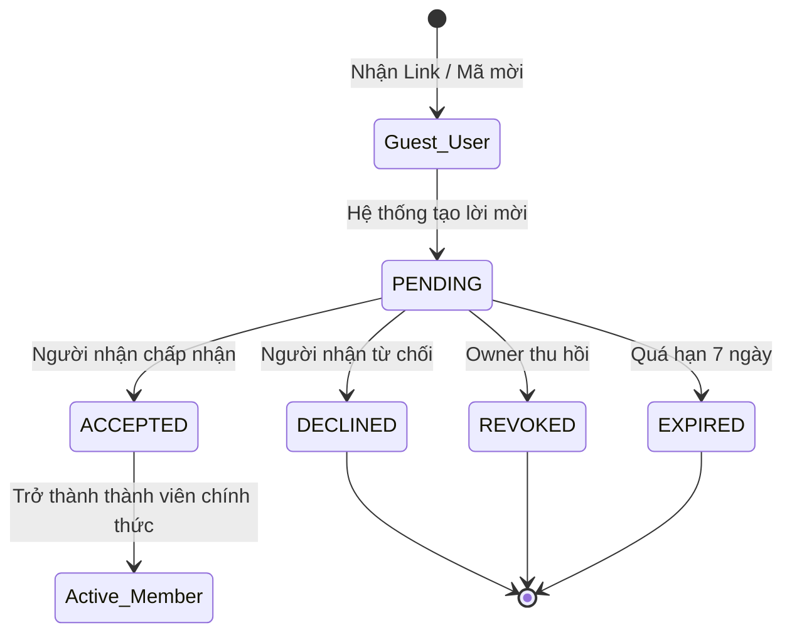
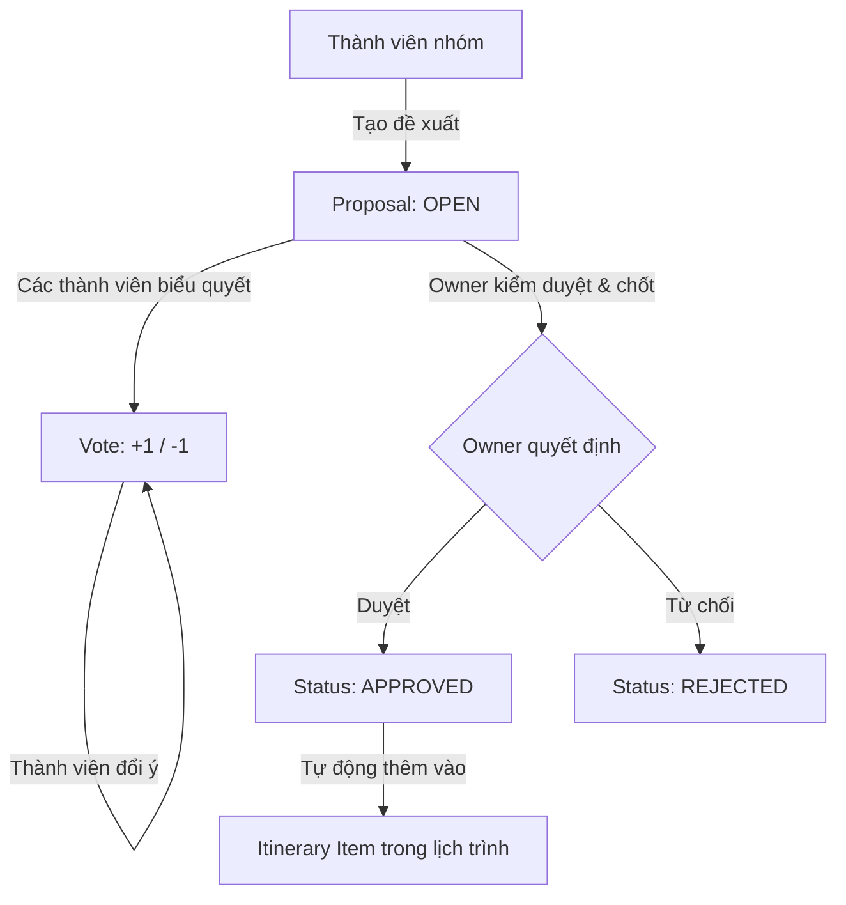

# TÀI LIỆU QUY TẮC NGHIỆP VỤ MODULE CỘNG TÁC NHÓM (COLLABORATION BUSINESS RULES)

> **Mã công việc:** W1-TV3-02  
> **Người phụ trách:** TV3 (Invited User / Trip Member)  
> **Phạm vi:** Invitations, Trip Members, Itinerary, Proposals, Voting  
> **Ngày phê duyệt:** Tuần 1 (20/10/2026)

---

## 1. LUỒNG PHÂN QUYỀN VÀ TRUY CẬP (OWNER → INVITATION → MEMBER)

Mọi thao tác thay đổi dữ liệu trong chuyến đi tuân thủ nguyên tắc:
1. **Kiểm tra quyền hạn tại dòng đầu tiên của API (TripAccessService):**
   - Chức năng chỉ dành cho Owner: gọi `tripAccessService.requireOwner(tripId, userId)`.
   - Chức năng dành cho Thành viên & Owner: gọi `tripAccessService.requireMember(tripId, userId)`.
   - Người ngoài chuyến đi thực hiện yêu cầu sẽ bị chặn ngay lập tức với HTTP **403 Forbidden**.
2. **Không query trực tiếp bảng `trips` hay `trip_members`:**
   - TV3 chỉ giao tiếp qua `TripAccessService` do TV2 cung cấp.

---

## 2. QUY TẮC 5 TRẠNG THÁI LỜI MỜI (INVITATION STATE MACHINE)

Lời mời tham gia chuyến đi có đúng 5 trạng thái hợp lệ:

| Trạng thái | Ý nghĩa | Ai được kích hoạt | Điều kiện chuyển tiếp |
|---|---|---|---|
| `PENDING` | Lời mời đã tạo, đang chờ người được mời phản hồi. | Owner hoặc Member | Duy nhất 1 lời mời `PENDING` cho mỗi email trong cùng chuyến đi. Trùng email trả về HTTP **409 Conflict**. |
| `ACCEPTED` | Người được mời đồng ý tham gia chuyến đi. | Người nhận lời mời | Lời mời phải đang ở trạng thái `PENDING` và chưa quá hạn `expires_at`. Chuyển người dùng thành `MEMBER` trong nhóm. |
| `DECLINED` | Người được mời từ chối tham gia. | Người nhận lời mời | Lời mời phải đang ở trạng thái `PENDING`. Không thêm vào danh sách thành viên. |
| `EXPIRED` | Lời mời hết hạn hiệu lực (mặc định sau 7 ngày kể từ khi tạo). | Hệ thống tự động / Lazy check | Khi người dùng cố gắng accept lời mời có `expires_at < now()`. Trả về HTTP **409 Conflict**. |
| `REVOKED` | Lời mời bị thu hồi bởi Chủ chuyến đi. | **Chỉ Owner** | Lời mời phải đang ở trạng thái `PENDING`. Member không có quyền thu hồi. |

### Bảng ma trận chuyển trạng thái hợp lệ:

| Từ trạng thái | Sang `PENDING` | Sang `ACCEPTED` | Sang `DECLINED` | Sang `EXPIRED` | Sang `REVOKED` |
|---|:---:|:---:|:---:|:---:|:---:|
| **(Mới tạo)** | ✅ | ❌ | ❌ | ❌ | ❌ |
| **`PENDING`** | ❌ | ✅ | ✅ | ✅ | ✅ |
| **`ACCEPTED`** | ❌ | ❌ | ❌ | ❌ | ❌ (Terminal) |
| **`DECLINED`** | ❌ | ❌ | ❌ | ❌ | ❌ (Terminal) |
| **`EXPIRED`** | ❌ | ❌ | ❌ | ❌ | ❌ (Terminal) |
| **`REVOKED`** | ❌ | ❌ | ❌ | ❌ | ❌ (Terminal) |

---

## 3. QUY TẮC LỊCH TRÌNH THEO NGÀY & ĐIỂM DỪNG (ITINERARY)

### 3.1. Ngày lịch trình (`itinerary_days`)
1. **Ràng buộc ngày đi và ngày về:**
   - Ngày cụ thể của mỗi ngày lịch trình (`date`) bắt buộc phải thỏa mãn:  
     $$\text{trips.start\_date} \le \text{itinerary\_days.date} \le \text{trips.end\_date}$$
2. **Số thứ tự ngày (`day_number`):**
   - Đếm bắt đầu từ `1`, tăng liên tục không ngắt quãng ($1, 2, 3...$).
   - Ràng buộc toàn vẹn duy nhất: `UNIQUE(trip_id, day_number)`. Nếu tạo trùng `day_number` trong cùng một chuyến đi, hệ thống trả về HTTP **409 Conflict**.
3. **Thứ tự sắp xếp mặc định:**
   - Khi trả về danh sách ngày, hệ thống luôn sắp xếp theo `day_number ASC`.

### 3.2. Điểm dừng trong ngày (`itinerary_items`)
1. **Liên kết với ngày:**
   - Mỗi item bắt buộc phải thuộc một `day_id` hợp lệ.
   - Khi một ngày bị xóa, toàn bộ item thuộc ngày đó tự động bị xóa theo (`ON DELETE CASCADE`).
2. **Khoảng thời gian hoạt động:**
   - Nếu có cả `start_time` và `end_time`, bắt buộc $\text{end\_time} \ge \text{start\_time}$.
3. **Sắp xếp thứ tự (`sort_order`):**
   - Mặc định là `0`. Điểm dừng trong cùng một ngày được sắp xếp theo `sort_order ASC, start_time ASC NULLS LAST`.
4. **Kiểm soát cập nhật đồng thời (Optimistic Concurrency Control):**
   - Khi gửi `PATCH /itinerary/items/{itemId}`, client gửi kèm trường `expected_updated_at`.
   - Nếu `item.updated_at != expected_updated_at`, hệ thống ném HTTP **409 Conflict** để ngăn chặn việc người này vô tình ghi đè chỉnh sửa của người khác.

---

## 4. QUY TẮC ĐỀ XUẤT ĐỊA ĐIỂM & BIỂU QUYẾT (PROPOSALS & VOTING)

1. **Tạo đề xuất (`proposals`):**
   - Bất kỳ thành viên nào (Owner hoặc Member) đều có quyền tạo đề xuất địa điểm với trạng thái ban đầu là `OPEN`.
2. **Biểu quyết (`votes`):**
   - Mỗi thành viên trong chuyến đi chỉ được có **tối đa 1 vote** cho mỗi đề xuất: `UNIQUE(proposal_id, voter_id)`.
   - Giá trị vote hợp lệ:
     - `+1`: Đồng ý / Tán thành (Upvote).
     - `-1`: Không đồng ý / Phản đối (Downvote).
   - Thành viên có quyền cập nhật lại vote của mình khi đề xuất vẫn ở trạng thái `OPEN`.
   - Không cho phép vote khi đề xuất đã đóng (`APPROVED` hoặc `REJECTED`).
3. **Phê duyệt đề xuất:**
   - **Chỉ Owner** mới có quyền chuyển trạng thái đề xuất sang `APPROVED` hoặc `REJECTED`.
   - Khi đề xuất được `APPROVED`, hệ thống tự động ghi nhận `reviewed_by = currentUserId`, `reviewed_at = now()`, đồng thời bắn thông báo in-app qua `NotificationService` tới các thành viên trong nhóm.

