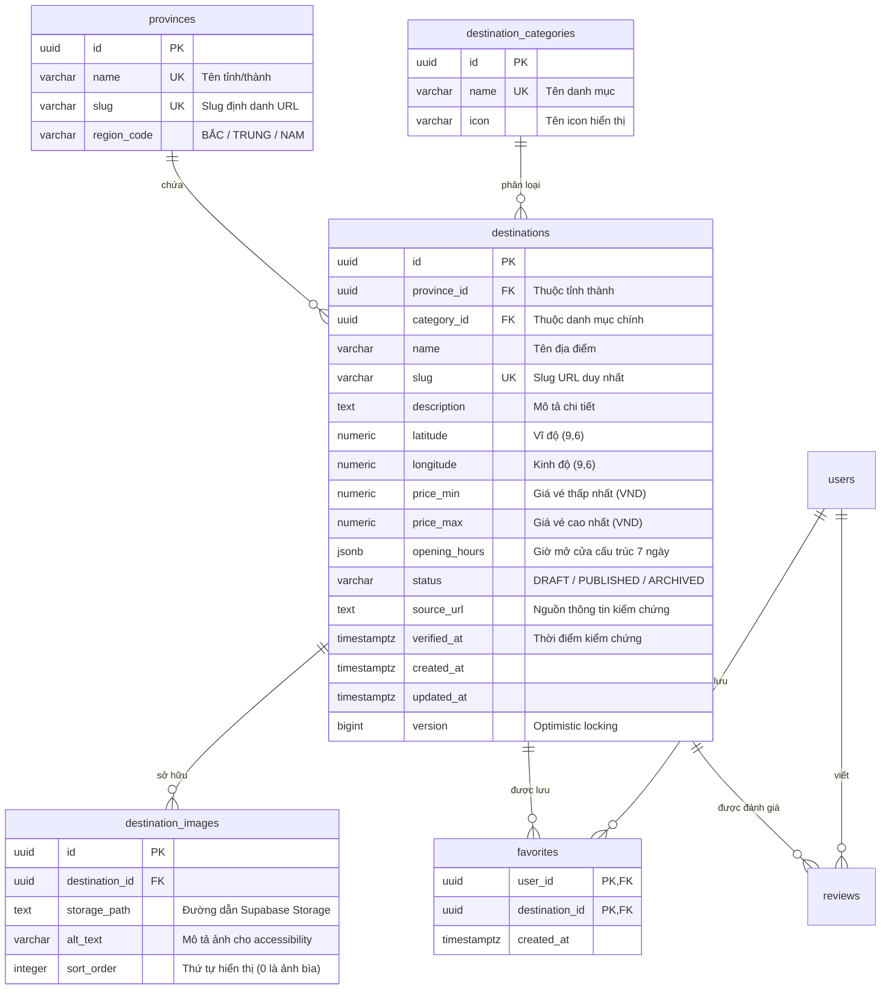

# ĐẶC TẢ CẤU TRÚC DỮ LIỆU ĐỊA ĐIỂM (DESTINATION DATA SCHEMA)

> **Mã công việc:** W1-TV1-03 & W1-TV1-04  
> **Người thực hiện:** TV1 (Guest / Visitor — Destination Discovery Lead)  
> **Người nhận review & tích hợp:** TV2 (Backend Core & Flyway Lead)  
> **Dự án:** VISTA — Vietnam Smart Travel Platform  
> **Mục tiêu:** Chốt chuẩn hóa cấu trúc dữ liệu địa điểm phục vụ Discovery, Search, Filter, Detail, Favorites, AI Planner (TV4) và Lịch trình nhóm (TV3).

---

## 1. MÔ HÌNH DỮ LIỆU QUAN HỆ (RELATIONAL ERD)

Dữ liệu địa điểm không bị nhồi nhét vào một bảng duy nhất mà được chuẩn hóa quan hệ (3NF) thành các thực thể rõ ràng:



---

## 2. TỪ ĐIỂN DỮ LIỆU CHI TIẾT BẢNG `destinations`

| Tên cột | Kiểu dữ liệu | Bắt buộc | Mặc định | Ràng buộc / Validation | Ý nghĩa nghiệp vụ |
|---|---|:---:|:---:|---|---|
| `id` | `UUID` | **Có** | `gen_random_uuid()` | Khóa chính | Định danh duy nhất toàn hệ thống. |
| `province_id` | `UUID` | **Có** | — | `FK REFERENCES provinces(id)` | Tỉnh/thành phố trực thuộc. |
| `category_id` | `UUID` | **Có** | — | `FK REFERENCES destination_categories(id)` | Danh mục chủ đạo (Di tích, Biển, Ẩm thực,...). |
| `name` | `VARCHAR(200)` | **Có** | — | Không rỗng, 2–200 ký tự | Tên hiển thị của điểm đến. |
| `slug` | `VARCHAR(220)` | **Có** | — | `UNIQUE`, chữ thường, gạch ngang | Định danh thân thiện trên URL / Deep link. |
| `description` | `TEXT` | Không | `NULL` | Tối đa 5.000 ký tự | Bài giới thiệu, điểm nhấn lịch sử, văn hóa. |
| `latitude` | `NUMERIC(9,6)` | Không | `NULL` | `-90.000000` đến `90.000000` | Tọa độ vĩ độ cho bản đồ MapViewAdapter. |
| `longitude` | `NUMERIC(9,6)` | Không | `NULL` | `-180.000000` đến `180.000000` | Tọa độ kinh độ cho bản đồ MapViewAdapter. |
| `price_min` | `NUMERIC(15,2)` | Không | `NULL` | `CHECK (price_min >= 0)` | Mức giá thấp nhất (VND). Xem mục 3. |
| `price_max` | `NUMERIC(15,2)` | Không | `NULL` | `CHECK (price_max >= price_min)` | Mức giá cao nhất (VND). Xem mục 3. |
| `opening_hours` | `JSONB` | Không | `NULL` | JSON hợp lệ theo Schema mục 4 | Cấu trúc giờ hoạt động các thứ trong tuần. |
| `status` | `VARCHAR(30)` | **Có** | `'DRAFT'` | `IN ('DRAFT', 'PUBLISHED', 'ARCHIVED')` | Trạng thái hiển thị. Chỉ `PUBLISHED` ra app. |
| `source_url` | `TEXT` | Không | `NULL` | Định dạng URL `http(s)://` | Link bài viết/cổng du lịch chính thống xác minh. |
| `verified_at` | `TIMESTAMPTZ` | Không | `NULL` | ISO 8601 UTC | Ngày giờ kiểm chứng thông tin thực địa. |
| `created_at` | `TIMESTAMPTZ` | **Có** | `now()` | — | Thời điểm tạo bản ghi. |
| `updated_at` | `TIMESTAMPTZ` | **Có** | `now()` | — | Thời điểm cập nhật cuối cùng. |
| `version` | `BIGINT` | **Có** | `0` | Không âm | Khóa lạc quan (Optimistic Locking) khi sửa CMS. |

---

## 3. QUY CHUẨN BIỂU DIỄN THÔNG TIN GIÁ (PRICING)

Hệ thống VISTA phục vụ cả khách du lịch tự túc và Trợ lý AI lập lịch trình (TV4), do đó thông tin giá vé phải có **ngữ nghĩa xử lý số học** (`NUMERIC`), tuyệt đối không lưu chuỗi tự do (như "tầm 5 chục nghìn"):

1. **Địa điểm miễn phí hoàn toàn:**
   - `price_min = 0` và `price_max = 0`.
   - *Ví dụ:* Cầu Rồng, Bãi biển Mỹ Khê, Chợ Đông Ba, Đồi Vọng Cảnh, Bãi biển An Bàng.
   - *Xử lý trên App/AI:* Bộ lọc "Miễn phí" (`priceMax = 0`) sẽ trả về nhóm này; AI Planner tính chi phí vé vào cổng = 0 VND.

2. **Địa điểm có một mức giá cố định:**
   - `price_min = price_max = X` (với `X > 0`).
   - *Ví dụ:* Đại Nội Huế (`price_min = 200000`, `price_max = 200000`), Lăng Khải Định (`150000`, `150000`), Bảo tàng Chăm (`60000`, `60000`).
   - *Xử lý trên App:* Hiển thị: `"200.000 VNĐ"`.

3. **Địa điểm có khoảng giá (vé thường vs vé combo / cáp treo):**
   - `price_min < price_max`.
   - *Ví dụ:* Bà Nà Hills (`900000` – `1250000`), Núi Thần Tài (`450000` – `650000`), Rừng dừa Bảy Mẫu (`150000` – `300000`).
   - *Xử lý trên App:* Hiển thị: `"900.000 - 1.250.000 VNĐ"`.
   - *Xử lý trên AI Planner:* AI có thể tính ngân sách dự kiến ở mức cận dưới hoặc cận trên tùy theo mức độ ngân sách của chuyến đi (`budget_total`).

4. **Địa điểm chưa có thông tin giá / dịch vụ tùy chọn:**
   - `price_min = NULL` và `price_max = NULL`.
   - *Quy tắc bắt buộc theo US-DEST-03:* Mobile hiển thị nhãn `"Chưa có thông tin giá vé"`, **cấm** tự ý hiển thị `0 VNĐ` (tránh hiểu lầm là miễn phí).

---

## 4. QUY CHUẨN BIỂU DIỄN GIỜ MỞ CỬA CÓ CẤU TRÚC (`opening_hours` JSONB)

Để backend có thể viết hàm kiểm tra `isOpenNow()`, và AI Planner (TV4) có thể xếp lịch trình thông minh không đưa khách đến địa điểm vào lúc đã đóng cửa, trường `opening_hours` sử dụng cấu trúc JSON chuẩn hóa sau:

### 4.1. JSON Schema Chuẩn

Khóa là 3 chữ cái tiếng Anh đại diện 7 ngày trong tuần: `mon`, `tue`, `wed`, `thu`, `fri`, `sat`, `sun`.

Giá trị là:
- Chuỗi khoảng thời gian: `"HH:mm-HH:mm"` (chuẩn 24 giờ, 4 chữ số kèm dấu hai chấm).
- Mở cửa cả ngày 24/7: `"00:00-23:59"`.
- Đóng cửa cả ngày: `"closed"`.
- Mở nhiều ca trong ngày: mảng các khoảng thời gian `["08:00-11:30", "13:30-17:00"]`.

### 4.2. Các Trường Hợp Thực Tế

#### Ca 1: Mở cửa thông thường hàng ngày (ví dụ 07:00 đến 17:30)
```json
{
  "mon": "07:00-17:30",
  "tue": "07:00-17:30",
  "wed": "07:00-17:30",
  "thu": "07:00-17:30",
  "fri": "07:00-17:30",
  "sat": "07:00-17:30",
  "sun": "07:00-17:30"
}
```

#### Ca 2: Điểm công cộng mở 24/7 (Cầu Rồng, Biển Mỹ Khê, Đèo Hải Vân)
```json
{
  "mon": "00:00-23:59",
  "tue": "00:00-23:59",
  "wed": "00:00-23:59",
  "thu": "00:00-23:59",
  "fri": "00:00-23:59",
  "sat": "00:00-23:59",
  "sun": "00:00-23:59"
}
```

#### Ca 3: Địa điểm nghỉ định kỳ (ví dụ nghỉ Thứ Hai để bảo trì)
```json
{
  "mon": "closed",
  "tue": "08:00-17:00",
  "wed": "08:00-17:00",
  "thu": "08:00-17:00",
  "fri": "08:00-17:00",
  "sat": "08:00-17:00",
  "sun": "08:00-17:00"
}
```

#### Ca 4: Mở theo ca sáng / chiều
```json
{
  "mon": ["08:00-11:30", "13:30-17:00"],
  "tue": ["08:00-11:30", "13:30-17:00"],
  "wed": ["08:00-11:30", "13:30-17:00"],
  "thu": ["08:00-11:30", "13:30-17:00"],
  "fri": ["08:00-11:30", "13:30-17:00"],
  "sat": "08:00-17:00",
  "sun": "08:00-17:00"
}
```

---

## 5. CHÍNH SÁCH NGUỒN THÔNG TIN & NGÀY XÁC MINH

1. **Quy định về `source_url`:**
   - Phải là đường link có thể truy cập được từ các cơ quan xúc tiến du lịch, di tích văn hóa quốc gia hoặc trang chủ doanh nghiệp điều hành:
     - Đà Nẵng: `danangfantasticity.com`, `nguhanhson.org.vn`, `chammuseum.vn`, `banahills.sunworld.vn`
     - Huế: `hueworldheritage.org.vn` (Trung tâm Bảo tồn Di tích Cố đô Huế), `khamphahue.com.vn`
     - Hội An: `hoianworldheritage.org.vn` (Trung tâm Quản lý Bảo tồn Di sản Văn hóa Hội An)
   - **Tuyệt đối cấm:** Bịa đặt URL không tồn tại, link 404 hoặc dùng domain rác.

2. **Quy định về `verified_at`:**
   - Ghi nhận ngày giờ UTC khi thành viên dự án hoặc biên tập viên trực tiếp tra cứu, đối chiếu giá vé và giờ mở cửa thực tế.
   - Định dạng chuẩn: `YYYY-MM-DDTHH:mm:ssZ` (ví dụ: `2026-10-15T00:00:00Z`).
   - Nếu dữ liệu chỉ là tổng hợp sơ bộ chưa kiểm chứng: để trường này là `NULL` và đặt `status = 'DRAFT'`.

---

## 6. CHIẾN LƯỢC XỬ LÝ DỮ LIỆU ĐẶC THÙ

1. **Xử lý trùng lặp (De-duplication):**
   - Không cho phép tồn tại 2 địa điểm trùng tên trong cùng một tỉnh/thành.
   - Chuẩn hóa Slug URL: `slug = slugify(unaccent(name))`. Khi trùng slug, thêm hậu tố phân biệt theo quận/huyện.
   - Index chống trùng: `UNIQUE(slug)` đã có trong schema.

2. **Cơ chế cập nhật dữ liệu (Idempotent Seed / Re-import):**
   - Khi chạy script nhập liệu CSV:
     - Khớp bản ghi theo `slug` hoặc cặp `(province, name)`.
     - Nếu đã có: Cập nhật các trường thông tin, giữ nguyên `id` để không làm đứt gãy khóa ngoại của `favorites`, `itinerary_items`, `reviews`.
     - Không xóa các địa điểm đã có nếu không nằm trong file CSV import.

3. **Xử lý ảnh liên kết (`image_reference`):**
   - Trong CSV: Dùng đường dẫn quy ước tương đối `destinations/<province_slug>/<destination_slug>.jpg`.
   - Khi nạp vào DB: Tạo bản ghi trong bảng `destination_images` với `sort_order = 0` (ảnh bìa) và sinh URL truy cập an toàn.
