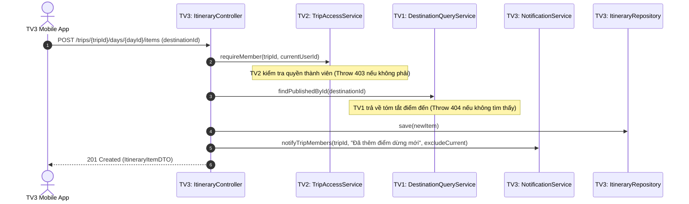
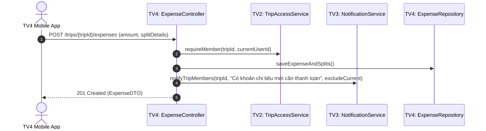

# RANH GIỚI MODULE THEO 5 ACTOR (ACTOR-DRIVEN MODULE BOUNDARIES)

> **Dự án:** VISTA — Vietnam Smart Travel Platform  
> **Kiến trúc:** Modular Monolith (Spring Boot 4.x, Java 21, React Native Expo, Supabase PostgreSQL 17)  
> **Mô hình sở hữu:** **Actor-Driven Development (TV1 – TV5)** kết hợp **Full-Stack Vertical Slices**

---

## 1. NGUYÊN TẮC THIẾT KẾ CỐT LÕI

Để 5 lập trình viên có thể code song song trọn vẹn từ Giao diện, API, Nghiệp vụ đến Database mà không bị xung đột (merge conflicts) và không bị phụ thuộc vòng (circular dependencies), hệ thống VISTA tuân thủ các nguyên tắc:

1. **Sở hữu trọn gói theo Actor:** Mỗi thành viên sở hữu trọn vẹn mã nguồn của Actor mình phụ trách từ Mobile/Admin đến Backend và Database Tables.
2. **Cấm gọi chéo Repository/Entity (No Cross-Module DB Queries):** Module của Actor $A$ **tuyệt đối không** inject Repository hoặc truy vấn trực tiếp Entity của Actor $B$.
3. **Giao tiếp hoàn toàn qua Public Service Interface:** Mọi nhu cầu chia sẻ dữ liệu hoặc thẩm định logic phải đi qua Interface công khai được định nghĩa ở package `application` của module chủ quản.
4. **Cung cấp Stub ngay từ Tuần 1:** Để không ai bị chặn (blocked), chủ sở hữu interface phải cung cấp bản triển khai giả lập (`Stub`) ngay từ tuần 1.

---

## 2. MA TRẬN PHÂN CHIA DOMAIN & SỞ HỮU THEO ACTOR

```mermaid
graph TD
    subgraph TV2_Core["TV2: Registered User / Trip Owner"]
        M_AUTH["com.vista.auth"]
        M_USER["com.vista.user"]
        M_TRIP["com.vista.trip (Core)"]
        M_COMMON["com.vista.common (Security, Audit)"]
        IF_TAS["TripAccessService"]
        IF_ALS["AuditLogService"]
    end

    subgraph TV1_Discovery["TV1: Guest / Visitor"]
        M_DEST["com.vista.destination"]
        M_FAV["com.vista.favorite"]
        IF_DQS["DestinationQueryService"]
        UI_FRAME["Mobile Frame / UI Kit"]
        ADMIN_WEB["Admin Web Shell"]
    end

    subgraph TV3_Collab["TV3: Invited User / Trip Member"]
        M_INV["com.vista.invitation"]
        M_ITIN["com.vista.itinerary"]
        M_VOTE["com.vista.voting"]
        M_NOTIF["com.vista.notification"]
        IF_NS["NotificationService"]
    end

    subgraph TV4_BudgetAI["TV4: Budget & AI Planner"]
        M_BUDGET["com.vista.budget"]
        M_AI["com.vista.ai (Gemini Client)"]
    end

    subgraph TV5_Safety["TV5: Community & Safety"]
        M_COMM["com.vista.community"]
        M_MOD["com.vista.moderation"]
        M_LOC["com.vista.location"]
        M_SAFE["com.vista.safety"]
        UI_MAP["MapViewAdapter (Mobile)"]
    end

    %% Dependencies
    M_ITIN -->|1. requireMember| IF_TAS
    M_ITIN -->|2. findPublishedById| IF_DQS
    M_ITIN -->|3. notifyTripMembers| IF_NS

    M_BUDGET -->|requireMember| IF_TAS
    M_BUDGET -->|notifyTripMembers| IF_NS
    M_AI -->|findPublishedById| IF_DQS

    M_SAFE -->|requireMember| IF_TAS
    M_SAFE -->|sendInAppNotification| IF_NS

    UI_FRAME -.->|Nhúng bản đồ| UI_MAP
```

---

## 3. CÁC HỢP ĐỒNG GIAO DIỆN CÔNG KHAI (PUBLIC SERVICE INTERFACES)

### 3.1. `TripAccessService` (Chủ sở hữu: TV2)
- **Vị trí:** [TripAccessService.java](file:///c:/Users/Lenovo%20LEGION%205/OneDrive/Desktop/VISTA/backend/src/main/java/com/vista/trip/application/TripAccessService.java)
- **Stub W1:** [StubTripAccessService.java](file:///c:/Users/Lenovo%20LEGION%205/OneDrive/Desktop/VISTA/backend/src/main/java/com/vista/trip/application/StubTripAccessService.java)
- **Bên tiêu thụ:** TV3 (Lịch trình & Lời mời), TV4 (Chi tiêu & AI), TV5 (Bản đồ nhóm & An toàn).
- **Mục đích:** Kiểm tra và thực thi quyền thành viên/chủ chuyến đi (`isMember`, `isOwner`, `requireMember`, `requireOwner`) trước khi thực hiện bất kỳ thao tác nhạy cảm nào.

### 3.2. `DestinationQueryService` (Chủ sở hữu: TV1)
- **Vị trí:** [DestinationQueryService.java](file:///c:/Users/Lenovo%20LEGION%205/OneDrive/Desktop/VISTA/backend/src/main/java/com/vista/destination/application/DestinationQueryService.java)
- **Stub W1:** [StubDestinationQueryService.java](file:///c:/Users/Lenovo%20LEGION%205/OneDrive/Desktop/VISTA/backend/src/main/java/com/vista/destination/application/StubDestinationQueryService.java)
- **Bên tiêu thụ:** TV3 (Thêm điểm dừng vào lịch trình), TV4 (AI gợi ý lịch trình dựa trên địa điểm có thật).
- **Mục đích:** Tra cứu điểm đến đã được kiểm duyệt và công khai (`findPublishedById`) mà không lộ Entity nội bộ `DestinationEntity`.

### 3.3. `NotificationService` (Chủ sở hữu: TV3)
- **Vị trí:** [NotificationService.java](file:///c:/Users/Lenovo%20LEGION%205/OneDrive/Desktop/VISTA/backend/src/main/java/com/vista/notification/application/NotificationService.java)
- **Stub W1:** [StubNotificationService.java](file:///c:/Users/Lenovo%20LEGION%205/OneDrive/Desktop/VISTA/backend/src/main/java/com/vista/notification/application/StubNotificationService.java)
- **Bên tiêu thụ:** TV2 (Thông báo khi mời thành viên), TV4 (Thông báo nhắc nợ / chia tiền), TV5 (Thông báo cảnh báo an toàn khẩn cấp).
- **Mục đích:** Bắn thông báo In-App và Push Notification tập trung, lưu vào bảng `notifications`.

### 3.4. `AuditLogService` (Chủ sở hữu: TV2)
- **Vị trí:** [AuditLogService.java](file:///c:/Users/Lenovo%20LEGION%205/OneDrive/Desktop/VISTA/backend/src/main/java/com/vista/common/audit/AuditLogService.java)
- **Stub W1:** [StubAuditLogService.java](file:///c:/Users/Lenovo%20LEGION%205/OneDrive/Desktop/VISTA/backend/src/main/java/com/vista/common/audit/StubAuditLogService.java)
- **Bên tiêu thụ:** Toàn bộ 5 Actor (TV1 – TV5).
- **Mục đích:** Ghi lại lịch sử các thao tác trọng yếu (thay đổi chủ sở hữu, chuyển tiền, xóa thành viên, khóa tài khoản, xử lý báo cáo vi phạm).

### 3.5. `MapViewAdapter` (Chủ sở hữu: TV5)
- **Vị trí:** [MapViewAdapter.tsx](file:///c:/Users/Lenovo%20LEGION%205/OneDrive/Desktop/VISTA/mobile/src/features/map/MapViewAdapter.tsx)
- **Bên tiêu thụ:** TV1 (Chi tiết điểm đến), TV2 (Xem bản đồ chuyến đi), TV3 (Lộ trình điểm dừng theo ngày).
- **Mục đích:** Cung cấp component bản đồ dùng chung, đóng gói logic marker, zoom, tọa độ mà không làm mã nguồn các bên khác dính chặt vào một thư viện Map cụ thể.

---

## 4. MA TRẬN SỞ HỮU CƠ SỞ DỮ LIỆU (DATABASE TABLES OWNERSHIP)

Tất cả 28 bảng nghiệp vụ trong Flyway Baseline Migration `V202610171200__baseline_schema.sql` đã được phân định chủ sở hữu duy nhất:

| Actor | Thành viên | Các bảng cơ sở dữ liệu thuộc quyền sở hữu |
|---|---|---|
| **Guest / Visitor** | **TV1** | `destinations`, `destination_categories`, `destination_reviews`, `favorites` (4 bảng) |
| **Registered User / Trip Owner** | **TV2** | `users`, `roles`, `user_roles`, `user_emergency_contacts`, `trips`, `trip_members`, `audit_logs` (7 bảng) |
| **Invited User / Trip Member** | **TV3** | `invitations`, `itinerary_days`, `itinerary_items`, `proposals`, `votes`, `notifications`, `device_tokens` (7 bảng) |
| **Trip Owner / Member (Budget & AI)** | **TV4** | `expenses`, `expense_splits`, `budgets`, `ai_generation_jobs`, `ai_feedback` (5 bảng) |
| **Community / Safety User** | **TV5** | `posts`, `post_comments`, `content_reports`, `moderation_events`, `check_ins`, `location_shares`, `meetup_points` (7 bảng) |

> ⚠️ **Quy tắc di cư tương lai:** Bất kỳ migration nào sau baseline phải do chính thành viên sở hữu bảng đó viết và đặt tên theo cú pháp: `V<timestamp>__<tv>_<mô_tả>.sql`. TV2 kiểm tra xung đột và hợp nhất vào nhánh `develop`.

---

## 5. KỊCH BẢN TƯƠNG TÁC ĐIỂN HÌNH GIỮA CÁC ACTOR

### Kịch bản 1: TV3 Thêm Điểm Dừng Vào Lịch Trình Chuyến Đi

### Kịch bản 2: TV4 Chia Tiền Chuyến Đi & Nhắc Nợ

---

*Tài liệu này là chuẩn mực kiến trúc bảo vệ ranh giới giữa 5 Actor trong suốt 8 tuần phát triển.*
