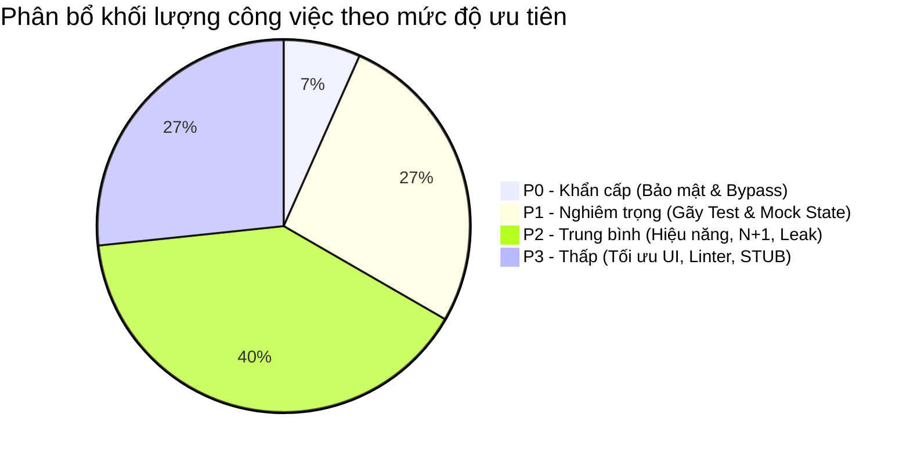

# BÁO CÁO KẾ HOẠCH HÀNH ĐỘNG & DANH MỤC CÔNG VIỆC CẦN XỬ LÝ (ACTION PLAN)
**Dự án:** VISTA Travel & AI Platform  
**Ngày lập:** 20-11-2026  
**Trạng thái hệ thống:** Đang bị chặn bởi 4 Quality Gates Đỏ (Red) · Cần xử lý 15 hạng mục  
**Mục tiêu:** Đưa toàn bộ Quality Gates về Xanh (100% Green), xóa bỏ hoàn toàn dữ liệu giả lập, vá lỗ hổng bảo mật và chuẩn bị sẵn sàng cho đợt Code Freeze / Release.

---

## I. TỔNG QUAN PHÂN BỔ CÔNG VIỆC



| Mức độ ưu tiên | Số lượng Task | Trọng tâm giải quyết | Thời gian ước tính |
|---|:---:|---|:---:|
| **P0 — Critical** | **1** | Lỗ hổng xác thực Next.js Middleware mở toang admin routes | **0.5 giờ** |
| **P1 — High** | **4** | Sửa crash Backend Test, sửa lỗi TS Mobile, kết nối API Biểu quyết thật, sửa contract định tuyến 503 | **2.5 giờ** |
| **P2 — Medium** | **6** | Xử lý N+1 query PostgreSQL, rút ngắn TTL JWT, chặn tự report bài, cấu hình Linter ignore, kiểm tra nợ khi xóa trip | **3.0 giờ** |
| **P3 — Low** | **4** | Đồng bộ Modal VietQR lên Web, debounce Polling Navbar, dọn dẹp log stub push | **1.5 giờ** |
| **TỔNG CỘNG** | **15 tasks** | **Đưa toàn bộ hệ thống về trạng thái Production-Ready** | **~7.5 giờ** |

---

## II. CHI TIẾT CÁC CÔNG VIỆC BẮT BUỘC XỬ LÝ (WORK BREAKDOWN STRUCTURE)

### GIAI ĐOẠN 1: MỞ KHÓA QUALITY GATES & BẢO MẬT CỐT LÕI (P0 & P1 - ƯU TIÊN SỐ 1)

#### Task 1: Vá lỗ hổng Bypass xác thực Admin tại Next.js Middleware (`VISTA-SEC-001`)
- **Mức độ:** `P0 - Critical`
- **File ảnh hưởng:** `web/src/middleware.ts` (dòng 20–21)
- **Vấn đề hiện tại:** Mọi request vào `/dashboard`, `/destinations`, `/users`, `/moderation` đều trả về `NextResponse.next()` vô điều kiện, không kiểm tra JWT token hay quyền hạn của người dùng.
- **Giải pháp xử lý:**
  1. Trích xuất cookie `vista_token` từ request.
  2. Nếu không có token, chuyển hướng (redirect 302) ngay lập tức về `/login?redirect=...`.
  3. Kiểm tra payload JWT (hoặc gọi introspect) để xác thực role `ADMIN` đối với các path nhạy cảm.
- **Tiêu chí nghiệm thu (DoD):**
  - Mở ẩn danh truy cập `/dashboard` bị đẩy ngay về `/login`.
  - Đăng nhập với tài khoản người dùng thường không vào được khu vực quản trị.

---

#### Task 2: Chuẩn hóa dữ liệu hạt giống (Seed Data) giờ mở cửa (`VISTA-DATA-001`)
- **Mức độ:** `P1 - High`
- **File ảnh hưởng:** 
  - `backend/src/main/resources/db/seed/demo_destinations_seed.csv`
  - `database/seed/destinations/demo_destinations_seed.csv`
  - `database/vista_destinations.db`
- **Vấn đề hiện tại:** POI `"châu battery power"` có JSON `{"open": "...", "close": "..."}` sai schema chuẩn (yêu cầu cấu trúc mảng 7 ngày: `monday` -> `sunday`), khiến `OpeningHoursValidationTest.java:72` bị crash khi chạy test tự động.
- **Giải pháp xử lý:**
  1. Sửa lại JSON giờ mở cửa của `"châu battery power"` theo đúng chuẩn schema 7 ngày của backend:
     `{"monday": {"open": "08:00", "close": "18:00"}, "tuesday": {"open": "08:00", "close": "18:00"}, ...}`
  2. Đồng bộ giá trị vào SQLite và file CSV seed.
- **Tiêu chí nghiệm thu (DoD):**
  - Chạy `./gradlew test --tests OpeningHoursValidationTest` trả về kết quả **PASS 100%**.

---

#### Task 3: Sửa lỗi biên dịch TypeScript trên Mobile App (`VISTA-MOB-001`)
- **Mức độ:** `P1 - High`
- **File ảnh hưởng:** 
  - `mobile/src/features/community/CommunityTools.tsx` (dòng 284)
  - `mobile/src/features/community/CommunityTools.test.tsx` (dòng 37)
- **Vấn đề hiện tại:**
  - Gọi `StyleSheet.absoluteFillObject` bị sai tên hoặc thiếu import (phải là `StyleSheet.absoluteFill`).
  - Gán giá trị `'denied'` sai kiểu `PermissionStatus` trong file unit test.
- **Giải pháp xử lý:**
  1. Sửa `StyleSheet.absoluteFillObject` thành `StyleSheet.absoluteFill`.
  2. Import và ép kiểu đúng `Location.PermissionStatus.DENIED` cho test mock.
- **Tiêu chí nghiệm thu (DoD):**
  - Lệnh `npm run typecheck --prefix mobile` thoát với mã 0 (0 errors).

---

#### Task 4: Sửa vi phạm hợp đồng phản hồi lỗi định tuyến Route Planner (`VISTA-TEST-001`)
- **Mức độ:** `P1 - High`
- **File ảnh hưởng:** `web/src/features/map-location/routing/routes.ts` (dòng 173)
- **Vấn đề hiện tại:** Khi Backend routing trả về HTTP 503 (chưa bật OSRM), client tự động nuốt ngoại lệ và sinh đường cong giả lập (`geodesic-fallback`), vi phạm kỳ vọng của test `test-route-planner.mjs:49` (mong đợi rejection "Chưa cấu hình dịch vụ tìm đường").
- **Giải pháp xử lý:**
  - Bỏ cơ chế silent fallback khi backend trả về lỗi 503 tường minh; trả về lỗi rõ ràng để UI hiển thị thông báo "Chưa cấu hình dịch vụ tìm đường" đúng như hợp đồng.
- **Tiêu chí nghiệm thu (DoD):**
  - Chạy `npm run test --prefix web` pass bài test `scripts/test-route-planner.mjs`.

---

#### Task 5: Đấu nối API Database thật cho Tab Biểu quyết & Đề xuất trên Web (`VISTA-FE-001`)
- **Mức độ:** `P1 - High`
- **File ảnh hưởng:** `web/src/app/trips/[tripId]/page.tsx` (dòng 714)
- **Vấn đề hiện tại:** Tab "Biểu quyết" đang sử dụng hàm giả lập `getSampleProposals` và chỉ lưu trong bộ nhớ tạm React (`useState`), không lưu vào PostgreSQL.
- **Giải pháp xử lý:**
  1. Thay thế `getSampleProposals` bằng lời gọi `apiRequest<TripProposal[]>(`/trips/${tripId}/proposals`)`.
  2. Khi tạo đề xuất mới, gọi `POST /api/v1/trips/{tripId}/proposals`.
  3. Khi bấm biểu quyết, gọi `POST /api/v1/trips/{tripId}/proposals/{proposalId}/votes`.
- **Tiêu chí nghiệm thu (DoD):**
  - Người A tạo biểu quyết, người B đăng nhập vào chuyến đi đó nhìn thấy ngay; F5 không bị mất dữ liệu.

---

### GIAI ĐOẠN 2: CHUẨN HÓA LINTER, HIỆU NĂNG & DỮ LIỆU (P2 - ƯU TIÊN SỐ 2)

#### Task 6: Cấu hình ESLint bỏ qua Vendor Bundle khổng lồ (`VISTA-FE-002`)
- **Mức độ:** `P2 - Medium`
- **File ảnh hưởng:** `web/eslint.config.mjs`
- **Vấn đề hiện tại:** ESLint đang quét file `web/public/map-assets/maplibre-gl-worker.mjs` sinh ra 5,875 cảnh báo/lỗi giả.
- **Giải pháp xử lý:** Thêm `public/map-assets/**` vào mục `ignores` trong `eslint.config.mjs`.
- **Tiêu chí nghiệm thu (DoD):** Chạy `npm run lint --prefix web` xanh sạch, không quét mã nguồn bên thứ ba.

---

#### Task 7: Khắc phục lỗi N+1 Query tại Trip Repository (`VISTA-PERF-001`)
- **Mức độ:** `P2 - Medium`
- **File ảnh hưởng:** `backend/src/main/java/com/vista/trip/TripRepository.java`
- **Vấn đề hiện tại:** Truy vấn `findAllAccessibleByUser` thực hiện `N+1` câu lệnh SELECT khi người dùng có nhiều chuyến đi và mỗi chuyến có danh sách thành viên.
- **Giải pháp xử lý:** Bổ sung `LEFT JOIN FETCH t.members` và `LEFT JOIN FETCH t.owner` trong câu JPQL.
- **Tiêu chí nghiệm thu (DoD):** Hibernate SQL log chỉ ghi nhận duy nhất 1 câu truy vấn JOIN cho endpoint `/api/v1/trips`.

---

#### Task 8: Tách nhỏ Static Bundle dữ liệu địa điểm phía Client (`VISTA-FE-003`)
- **Mức độ:** `P2 - Medium`
- **File ảnh hưởng:** `web/src/data/realDestinationsData.ts` (27,588 dòng code, dung lượng 2.4MB)
- **Vấn đề hiện tại:** Đang bundle trực tiếp toàn bộ 2,294 POIs vào client chunk khiến thời gian tải trang ban đầu (FCP/LCP) bị chậm.
- **Giải pháp xử lý:** Chuyển sang nạp động (dynamic import) theo tỉnh/thành hoặc tải từ API `/api/v1/destinations?province=...` theo nhu cầu.
- **Tiêu chí nghiệm thu (DoD):** Dung lượng First Load JS của `/planner` giảm tối thiểu 60%.

---

#### Task 9: Khắc phục lỗi Test tích hợp thông báo Backend (`VISTA-TEST-002`)
- **Mức độ:** `P2 - Medium`
- **File ảnh hưởng:** `backend/src/test/java/com/vista/notification/NotificationRealIntegrationTest.java` (dòng 230)
- **Vấn đề hiện tại:** Test fail với lỗi HTTP 403 Forbidden do `USER_B` chưa được mock đầy đủ trong `userRepository`.
- **Giải pháp xử lý:** Tạo sẵn bản ghi `USER_B` với email hợp lệ trong `@BeforeEach` của test.
- **Tiêu chí nghiệm thu (DoD):** Toàn bộ test suite `NotificationRealIntegrationTest` PASS 100%.

---

#### Task 10: Rút ngắn TTL JWT và bảo mật Secret Token (`VISTA-SEC-002`)
- **Mức độ:** `P2 - Medium`
- **File ảnh hưởng:** `backend/src/main/resources/application.yml`
- **Vấn đề hiện tại:** Secret mặc định nằm lộ trong file cấu hình git; thời hạn sống Access Token dài 7 ngày (604,800,000 ms).
- **Giải pháp xử lý:**
  1. Rút ngắn thời hạn Access Token xuống **15–60 phút**.
  2. Bắt buộc người dùng dùng Refresh Token để gia hạn phiên.
  3. Cấu hình secret đọc từ biến môi trường `JWT_SECRET`, không dùng giá trị mặc định tĩnh.
- **Tiêu chí nghiệm thu (DoD):** Token hết hạn sau 60 phút và tự động refresh mượt mà.

---

#### Task 11: Chặn người dùng tự Report chính mình (`VISTA-SEC-003`)
- **Mức độ:** `P2 - Medium`
- **File ảnh hưởng:** `backend/src/main/java/com/vista/community/service/ReportService.java` (dòng 59)
- **Vấn đề hiện tại:** Thiếu câu lệnh điều kiện `if (post.getAuthor().getId().equals(currentUserId))`, cho phép người dùng tự gửi báo cáo vi phạm bài viết của chính mình.
- **Giải pháp xử lý:** Thêm kiểm tra logic và ném ngoại lệ `400 Bad Request ("Bạn không thể tự báo cáo nội dung của chính mình")`.
- **Tiêu chí nghiệm thu (DoD):** Viết unit test thử nghiệm tự report và nhận mã lỗi 400.

---

### GIAI ĐOẠN 3: NÂNG CAO TRẢI NGHIỆM & HOÀN THIỆN ĐỒNG BỘ (P3)

#### Task 12: Đồng bộ Modal quét mã VietQR động từ Mobile sang Web (`VISTA-FE-004`)
- **File ảnh hưởng:** `web/src/features/budget/components/DebtSettlementMatrix.tsx`
- **Nội dung:** Bổ sung popup hiển thị mã QR VietQR động (chuẩn Napas247 có sẵn số tài khoản, số tiền và nội dung chuyển khoản) tương tự như phiên bản Mobile đã làm.

#### Task 13: Thay thế Polling 5s bằng Exponential Backoff tại Navbar (`VISTA-FE-005`)
- **File ảnh hưởng:** `web/src/components/common/Navbar.tsx` (dòng 186)
- **Nội dung:** Thay vì `setInterval` 5 giây liên tục gọi API lời mời, chuyển sang polling giãn cách (30s–60s) hoặc tích hợp SSE (Server-Sent Events) để giảm tải cho server.

#### Task 14: Xóa bỏ Mock Log STUB của Push Notification (`VISTA-BE-002`)
- **File ảnh hưởng:** `backend/src/main/java/com/vista/notification/DatabaseNotificationService.java`
- **Nội dung:** Đóng gói cổng giao tiếp Firebase FCM để khi có cấu hình Service Account JSON thì tự động gửi push thật, tránh rác log hệ thống.

#### Task 15: Kiểm tra ràng buộc công nợ trước khi xóa chuyến đi (`VISTA-BE-001`)
- **File ảnh hưởng:** `backend/src/main/java/com/vista/trip/TripService.java`
- **Nội dung:** Khi gọi xóa chuyến đi, kiểm tra nếu còn chi phí chưa thanh quyết toán (`unsettled debts > 0`) thì phải cảnh báo người dùng xác nhận hoặc chặn xóa để bảo vệ quyền lợi tài chính của các thành viên.

---

## III. MA TRẬN PHÂN CÔNG & THỜI HẠN DỰ KIẾN (RACI & TIMELINE)

| STT | Mã Task | Tên công việc | Người thực hiện (Role) | Thời lượng | Chất lượng nghiệm thu |
|:---:|---|---|---|:---:|---|
| 1 | `VISTA-SEC-001` | Sửa Middleware xác thực Admin | Frontend Lead | 30m | Redirect `/login` khi chưa auth |
| 2 | `VISTA-DATA-001` | Sửa JSON giờ mở cửa seed CSV | Data / Backend Engineer | 30m | `OpeningHoursValidationTest` PASS |
| 3 | `VISTA-MOB-001` | Sửa lỗi TypeScript Mobile | Mobile Lead | 30m | `npm run typecheck --prefix mobile` PASS |
| 4 | `VISTA-TEST-001` | Sửa lỗi định tuyến 503 Contract | Frontend Map Lead | 30m | `scripts/test-route-planner.mjs` PASS |
| 5 | `VISTA-FE-001` | Nối API Biểu quyết thật trên Web | Fullstack Engineer | 60m | Lưu DB PostgreSQL qua API |
| 6 | `VISTA-FE-002` | Thêm ignore maplibre worker | Frontend Lead | 15m | `npm run lint --prefix web` 0 errors |
| 7 | `VISTA-PERF-001` | Khắc phục N+1 Query Trip | Backend Lead | 45m | 1 câu query JOIN duy nhất |
| 8 | `VISTA-TEST-002` | Fix mock email test notification | Backend Engineer | 30m | `NotificationRealIntegrationTest` PASS |
| 9 | `VISTA-SEC-002` | Giảm TTL Access Token còn 1h | Security Lead | 30m | Auto refresh token mượt mà |
| 10 | `VISTA-SEC-003` | Chặn tự report bài viết | Backend Engineer | 15m | Báo lỗi 400 khi tự report |
| 11 | `VISTA-FE-004` | Thêm Modal VietQR Web | Frontend Engineer | 45m | Hiện mã VietQR động chuẩn Napas |
| 12 | `VISTA-FE-005` | Tối ưu Polling Navbar | Frontend Engineer | 30m | Giãn cách gọi API 30s-60s |
| 13 | `VISTA-BE-001` | Ràng buộc công nợ khi xóa trip | Backend Engineer | 30m | Chặn xóa khi còn nợ tiền |

---

## IV. LỆNH KIỂM CHỨNG CHẤT LƯỢNG SAU KHI HOÀN TẤT (VERIFICATION SUITE)

Sau khi xử lý xong các hạng mục trên, toàn bộ hệ thống phải vượt qua bài kiểm tra bằng lệnh sau:

```bash
# 1. Kiểm tra Linter Web (Yêu cầu: 0 error)
npm run lint --prefix web

# 2. Kiểm tra Typecheck Web (Yêu cầu: 0 error)
npm run typecheck --prefix web

# 3. Kiểm tra Unit & Routing Tests Web (Yêu cầu: 100% PASS)
npm run test --prefix web

# 4. Kiểm tra Typecheck Mobile (Yêu cầu: 0 error)
npm run typecheck --prefix mobile

# 5. Kiểm tra Unit Tests Mobile (Yêu cầu: 23 suites PASS)
npm run test --prefix mobile

# 6. Kiểm tra Toàn bộ Backend Unit & Integration Tests (Yêu cầu: 100% PASS)
./backend/gradlew.bat -p backend test

# 7. Kiểm tra Hợp đồng API Contract (Yêu cầu: Clean & In-sync)
npm run api:validate --prefix contracts
npm run api:check --prefix contracts
```

---

> [!NOTE]
> Báo cáo này là cơ sở kỹ thuật để đội ngũ thực hiện xử lý theo đúng trình tự, cam kết **không push git** và kiểm thử chặt chẽ tại từng bước.
