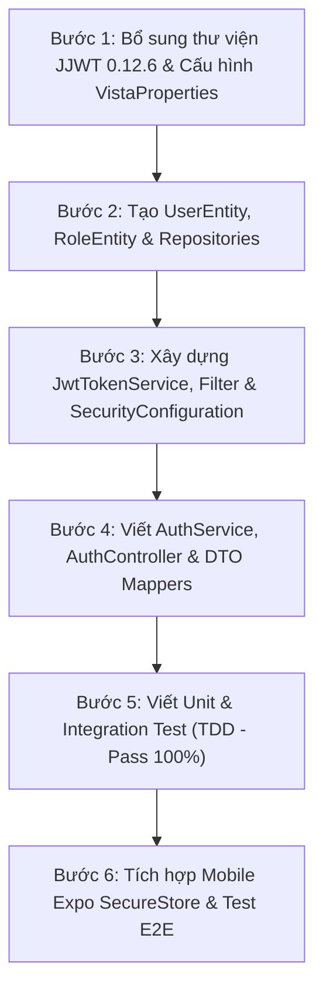

# KẾ HOẠCH TRIỂN KHAI CHI TIẾT: XÁC THỰC & PHÂN QUYỀN (AUTH & RBAC FOUNDATION)

> **Mô-đun:** `com.vista.auth` & `com.vista.user`  
> **Chủ sở hữu:** **TV2 (Registered User / Trip Owner & Backend Core)**  
> **Mục tiêu:** Cung cấp hạ tầng bảo mật JWT và phân quyền người dùng chuẩn Production, mở khóa cho toàn bộ 4 thành viên (TV1, TV3, TV4, TV5) phát triển các API private.

---

## 1. CÁC NGUYÊN TẮC KỸ THUẬT ĐÃ CHỐT

1. **Đường dẫn API:**
   - `POST /api/v1/auth/register` (Tạo tài khoản mới)
   - `POST /api/v1/auth/login` (Đăng nhập hệ thống)
   - `GET /api/v1/auth/me` (Lấy thông tin tài khoản đang đăng nhập)
2. **Bảo mật mật khẩu:**
   - Sử dụng thuật toán `BCryptPasswordEncoder` với độ phức tạp (work factor) là 12.
   - Tuyệt đối không bao giờ lưu mật khẩu gốc dạng văn bản thô (plain text).
   - Không trả về trường `password_hash` trong bất kỳ response DTO nào.
3. **Cơ chế Token (JWT):**
   - Sử dụng thư viện `io.jsonwebtoken:jjwt` phiên bản `0.12.6`.
   - Thuật toán ký: HMAC-SHA256 (`HS256`).
   - Khóa bí mật (`JWT_SECRET`) phải có độ dài tối thiểu 256 bits, đọc từ biến môi trường, tuyệt đối không hardcode.
   - Thời hạn Token:
     - Access Token: `24 giờ`
     - Refresh Token: `7 ngày`
   - Payload Claims bao gồm: `sub` (User UUID), `email`, `roles` (`["ROLE_USER", ...]`), `iat`, `exp`.
4. **Phân quyền người dùng (RBAC):**
   - 3 vai trò toàn cục cố định: `USER`, `MODERATOR`, `ADMIN` (đã có sẵn trong bảng `roles`).
   - Người dùng đăng ký mới luôn luôn được gán vai trò mặc định là `USER`.
   - Cấm client tự ý truyền hoặc lựa chọn vai trò khi đăng ký.
5. **Mã trạng thái HTTP & Chuẩn lỗi RFC 9457:**
   - Đăng ký thành công: `201 Created` kèm `AuthResponse`.
   - Đăng ký trùng email: `409 Conflict` (`DUPLICATE_EMAIL`).
   - Sai tài khoản / mật khẩu: `401 Unauthorized` (`INVALID_CREDENTIALS`).
   - Không có token khi gọi endpoint riêng tư: `401 Unauthorized` (`UNAUTHORIZED`).
   - Có token nhưng không đủ thẩm quyền vai trò: `403 Forbidden` (`FORBIDDEN`).
   - Dữ liệu đầu vào sai định dạng: `400 Bad Request` (`VALIDATION_ERROR`).
6. **Cơ sở dữ liệu (Supabase PostgreSQL 17):**
   - Sử dụng 3 bảng đã khởi tạo trong Flyway Baseline Migration: `users`, `roles`, `user_roles`.
   - Không cần sửa đổi schema hay thêm bảng mới ở giai đoạn này.

---

## 2. LỘ TRÌNH 6 BƯỚC THỰC HIỆN CHI TIẾT



---

### BƯỚC 1: Bổ sung Thư viện JWT & Cấu hình Biến Môi Trường
- **File cần chỉnh sửa:** `backend/build.gradle`
  - Thêm cụm thư viện JJWT 0.12.6:
    ```groovy
    implementation 'io.jsonwebtoken:jjwt-api:0.12.6'
    runtimeOnly 'io.jsonwebtoken:jjwt-impl:0.12.6'
    runtimeOnly 'io.jsonwebtoken:jjwt-jackson:0.12.6'
    ```
- **File cấu hình:** `backend/src/main/resources/application.yml` & `application-demo.yml`:
  ```yaml
  vista:
    jwt:
      secret: ${JWT_SECRET:vista-smart-travel-super-secure-jwt-secret-key-2026-minimum-256-bits!}
      access-token-expiration-ms: ${JWT_ACCESS_EXPIRATION_MS:86400000} # 24h
      refresh-token-expiration-ms: ${JWT_REFRESH_EXPIRATION_MS:604800000} # 7 days
  ```
- **Cập nhật:** Class `VistaProperties.java` để ánh xạ cấu hình `jwt.secret` an toàn kiểu type-safe.

---

### BƯỚC 2: Tạo UserEntity, RoleEntity & Spring Data Repositories
- **Tạo `RoleEntity.java` (`com.vista.auth.domain`):**
  - Ánh xạ bảng `roles`:
    - `id`: UUID (Khóa chính)
    - `code`: String (varchar 30: `USER`, `MODERATOR`, `ADMIN`)
- **Tạo `UserEntity.java` (`com.vista.user.domain`):**
  - Ánh xạ bảng `users`:
    - `id`: UUID (Khóa chính)
    - `email`: String (varchar 320, unique)
    - `passwordHash`: String (varchar 255)
    - `displayName`: String (varchar 120)
    - `avatarUrl`: String (text)
    - `status`: String (`ACTIVE`, `INACTIVE`, `BANNED`)
    - `roles`: `Set<RoleEntity>` với quan hệ `@ManyToMany` qua bảng nối `user_roles`.
    - `createdAt`: Instant
    - `updatedAt`: Instant
    - `version`: Long (`@Version` phục vụ Optimistic Locking)
- **Tạo `UserRepository.java`:**
  - `Optional<UserEntity> findByEmailIgnoreCase(String email);`
  - `boolean existsByEmailIgnoreCase(String email);`
- **Tạo `RoleRepository.java`:**
  - `Optional<RoleEntity> findByCode(String code);`

---

### BƯỚC 3: Xây dựng JwtTokenService, JwtAuthenticationFilter & SecurityConfiguration
- **Tạo `JwtTokenService.java` (`com.vista.auth.application`):**
  - Hàm `generateAccessToken(UserEntity user)`: tạo JWT HMAC-SHA256 chứa `userId`, `email`, danh sách quyền `ROLE_<CODE>`.
  - Hàm `generateRefreshToken(UserEntity user)`.
  - Hàm `validateToken(String token)`: kiểm tra chữ ký số và thời hạn.
  - Hàm `extractUserId(String token)` & `extractRoles(String token)`.
- **Tạo `JwtAuthenticationFilter.java` (`com.vista.common.security`):**
  - Kế thừa `OncePerRequestFilter`.
  - Trích xuất header `Authorization: Bearer <token>`.
  - Nếu token hợp lệ: Khởi tạo đối tượng `UsernamePasswordAuthenticationToken` chứa thông tin user và danh sách `GrantedAuthority`, đưa vào `SecurityContextHolder`.
  - Nếu token lỗi / hết hạn: Bỏ qua hoặc bắn ngoại lệ rõ ràng, không để request vượt tường lửa.
- **Cập nhật `SecurityConfiguration.java`:**
  - Bổ sung `jwtAuthenticationFilter` chạy trước `UsernamePasswordAuthenticationFilter`.
  - Cấu hình phân quyền endpoint:
    - Public: `/api/v1/auth/register`, `/api/v1/auth/login`, `/api/v1/health`, `/swagger-ui/**`, `/v3/api-docs/**`, `GET /api/v1/destinations/**`.
    - Protected: `/api/v1/auth/me`, `/api/v1/trips/**`, `/api/v1/users/**` bắt buộc xác thực.
  - Cấu hình `AuthenticationEntryPoint` và `AccessDeniedHandler` trả về cấu trúc lỗi chuẩn RFC 9457 `ProblemDetail`.

---

### BƯỚC 4: Hoàn thiện AuthService, AuthController & DTOs
- **Tạo `AuthService.java` (`com.vista.auth.application`):**
  - `register(RegisterRequest request)`:
    1. Kiểm tra email đã tồn tại hay chưa qua `userRepository.existsByEmailIgnoreCase`. Nếu trùng ➔ ném `EmailAlreadyExistsException` (409 Conflict).
    2. Mã hóa mật khẩu: `passwordEncoder.encode(request.password())`.
    3. Tìm vai trò mặc định `USER` từ `roleRepository`.
    4. Khởi tạo `UserEntity` với vai trò `USER`, trạng thái `ACTIVE`.
    5. Lưu vào Database qua `userRepository.save()`.
    6. Sinh Access Token & Refresh Token.
    7. Ghi audit log qua `auditLogService.logAction(...)`.
    8. Trả về `AuthResponse`.
  - `login(LoginRequest request)`:
    1. Tìm user theo email. Nếu không tồn tại hoặc trạng thái khác `ACTIVE` ➔ ném `BadCredentialsException` (401 Unauthorized).
    2. Kiểm tra mật khẩu qua `passwordEncoder.matches(request.password(), user.getPasswordHash())`. Nếu sai ➔ ném `BadCredentialsException` (401).
    3. Sinh Access Token & Refresh Token mới.
    4. Trả về `AuthResponse`.
  - `getCurrentUser(UUID userId)`:
    1. Trích xuất profile người dùng hiện tại phục vụ API `/api/v1/auth/me`.
- **Tạo `AuthController.java` (`com.vista.auth.api`):**
  - `POST /api/v1/auth/register` ➔ trả về `201 Created`.
  - `POST /api/v1/auth/login` ➔ trả về `200 OK`.
  - `GET /api/v1/auth/me` ➔ lấy `Principal` hiện tại, trả về `200 OK`.
- **Cập nhật `GlobalExceptionHandler.java`:**
  - Bổ sung handler cho `EmailAlreadyExistsException` (409 Conflict).
  - Bổ sung handler cho `BadCredentialsException` (401 Unauthorized).
  - Bổ sung handler cho `AccessDeniedException` (403 Forbidden).

---

### BƯỚC 5: Viết Kiểm Thử Tự Động (Unit & Integration Tests)
- **Kiểm thử Unit (`JwtTokenServiceTest.java`):**
  - Kiểm tra sinh token và parse claims chính xác.
  - Kiểm tra token hết hạn bị từ chối.
  - Kiểm tra token bị chỉnh sửa chữ ký bị ném lỗi `SignatureException`.
- **Kiểm thử Tích Hợp API (`AuthControllerIntegrationTest.java`):**
  - Ca 1: Đăng ký tài khoản mới thành công (HTTP 201, trả về token, role `ROLE_USER`).
  - Ca 2: Đăng ký trùng email (HTTP 409 Conflict).
  - Ca 3: Đăng nhập đúng thông tin (HTTP 200 OK, trả về token hợp lệ).
  - Ca 4: Đăng nhập sai mật khẩu (HTTP 401 Unauthorized).
  - Ca 5: Gọi endpoint riêng tư `GET /api/v1/auth/me` không có token (HTTP 401).
  - Ca 6: Gọi endpoint riêng tư `GET /api/v1/auth/me` với Bearer token vừa đăng nhập (HTTP 200 OK).
- **Tiêu chuẩn nghiệm thu:** Chạy lệnh `./gradlew.bat spotlessApply test` đạt **BUILD SUCCESSFUL 100%**.

---

### BƯỚC 6: Tích Hợp Mobile & Kiểm Thử Đầu Cuối (Mobile End-to-End)
- **Tạo API Client cho Auth (`mobile/src/features/auth/services/authApi.ts`):**
  - Viết hàm `registerApi(payload)` gọi `POST /api/v1/auth/register`.
  - Viết hàm `loginApi(payload)` gọi `POST /api/v1/auth/login`.
- **Tạo Token Storage (`mobile/src/services/storage/tokenStorage.ts`):**
  - Lưu và lấy token an toàn qua thư viện `expo-secure-store`.
- **Gắn Token vào HTTP Interceptor (`mobile/src/services/api/client.ts`):**
  - Mọi request phát ra tự động đính kèm `Authorization: Bearer <accessToken>`.
  - Khi server trả về mã lỗi 401, tự động xóa token và điều hướng người dùng về màn hình đăng nhập.
- **Kết nối Giao Diện:**
  - Màn hình `LoginScreen.tsx` kết nối với API đăng nhập.
  - Màn hình `RegisterScreen.tsx` kết nối với API đăng ký.
- **Tiêu chuẩn nghiệm thu:** `npm run typecheck` trên Mobile đạt 0 lỗi, đăng nhập thử thành công và lưu được token vào bộ nhớ máy.

---

### ĐẦU RA BÀN GIAO CHO CẢ ĐỘI (HANDOVER DELIVERABLES)
Sau khi hoàn thành 6 bước trên:
1. Bạn có sẵn một backend có hệ thống Auth hoàn chỉnh, có tài khoản mẫu (`testuser@vista.vn`).
2. Cung cấp file hướng dẫn cho 4 bạn: *"Muốn gọi API private, chỉ cần truyền header `Authorization: Bearer <token>`"*.
3. Đẩy toàn bộ mã nguồn sạch lên nhánh `dev` để 4 thành viên kéo về bắt đầu các task Tuần 2.
